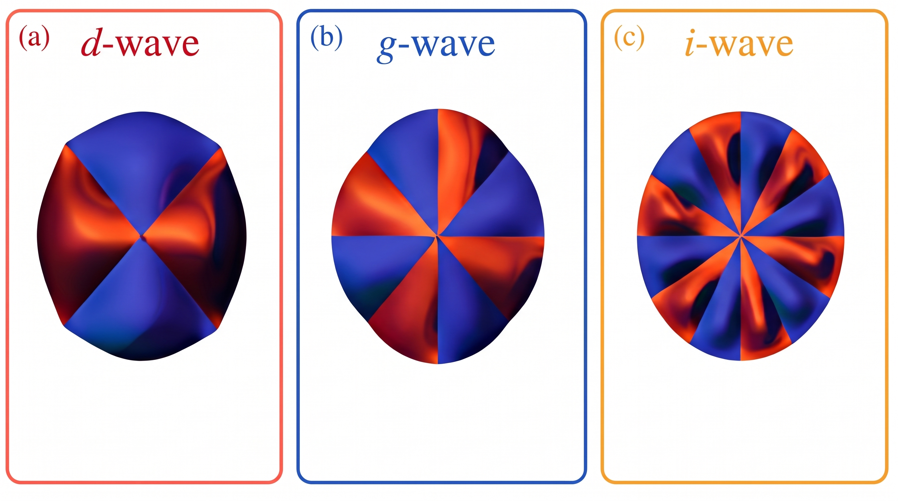

# Altermagnets: d-, g- and i-wave spin splitting
 
 
## Summary

An altermagnet is a compensated magnet: it has zero net magnetization like an antiferromagnet, yet its electronic bands are spin-split like a ferromagnet's. The splitting depends on the direction of the electron's momentum and changes sign around the Brillouin zone.
<figure>
  
  <figcaption>Schematic illustration of d-, g-, and i-wave momentum-dependent spin splitting. Source: R. Tamang et al., arXiv:2412.05377 (2024).
  </figcaption>
</figure>
The labels d-wave, g-wave and i-wave name the angular symmetry of that splitting in momentum space. They count 2, 4 and 6 nodal planes through Γ respectively. They say nothing about the real-space shape of the moments or the number of magnetic atoms or domains.
 
The practical appeal is the combination of no stray field with spin-polarized transport, which is why altermagnets are studied for spintronic memory and logic.
 
## Momentum-dependent spin splitting
 
Spin splitting means that a spin-up and a spin-down electron at the same momentum **k** have different energies. In a nonmagnetic metal the two are degenerate:
 
$$
E_{\uparrow}(\mathbf{k}) = E_{\downarrow}(\mathbf{k})
$$
 
In an altermagnet this degeneracy is lifted over most of the Brillouin zone, so each band separates into a spin-up and a spin-down branch:
 
$$
E_{\uparrow}(\mathbf{k}) \neq E_{\downarrow}(\mathbf{k}), \qquad \Delta_s(\mathbf{k}) \equiv E_{\uparrow}(\mathbf{k}) - E_{\downarrow}(\mathbf{k})
$$
 
Momentum-dependent means the splitting is not uniform. Along one crystal direction spin-up lies lower; along another, spin-down does. Three properties define the altermagnetic case:
 
- **Sign alternation.** The splitting takes both signs, and they cancel on integrating over the zone, so the net magnetization stays zero.
- **Nodes.** On symmetry-enforced nodal planes the splitting vanishes and the two spin branches are degenerate again.
- **Even parity.** The splitting is the same at **k** and −**k**, which restricts it to even partial waves: d, g, i.
$$
\Delta_s(\mathbf{k}) = \Delta_s(-\mathbf{k})
$$
 
The simplest d-wave form is
 
$$
\Delta_s(\mathbf{k}) \propto k_x^2 - k_y^2
$$
 
It is largest and positive along the $k_x$ axis, equal and negative along $k_y$, and zero on the diagonals $k_x = \pm k_y$. A 90° rotation of the momentum reverses its sign, the same four-lobed pattern as a $d_{x^2-y^2}$ orbital.
 
## Symmetry origin
 
What separates an altermagnet from a conventional antiferromagnet is the symmetry operation that maps one spin sublattice onto the other.
 
In a conventional antiferromagnet the opposite-spin sublattices are related by a translation or by inversion. Combined with time reversal, that symmetry forces the bands to be spin-degenerate at every **k** unless spin–orbit coupling intervenes.
 
In an altermagnet the sublattices are related only by a crystal rotation or mirror. The local environments of the two sublattices are rotated copies of each other, so an electron moving along one direction sees a different sublattice than one moving along the rotated direction. The result is a spin splitting that is nonrelativistic (it needs no spin–orbit coupling) and that rotates into its own negative under the connecting operation.
 
| Magnetic class | Net magnetization | Spin splitting | Sublattice relation |
| --- | --- | --- | --- |
| Ferromagnet | Nonzero | Present, roughly uniform in k | All moments parallel |
| Conventional antiferromagnet | Zero | Absent without spin–orbit coupling | Translation or inversion |
| Altermagnet | Zero | Present, sign-alternating in k (d, g or i-wave) | Rotation or mirror |
 
## The d-, g- and i-wave classes
 
The three classes differ only in how many symmetry-protected nodal planes pass through Γ, and therefore in how often the splitting changes sign as the momentum direction rotates.
 
| Class | Nodal planes through Γ | Lobes (planar form) | Sign change every | Angular dependence (planar form) |
| --- | --- | --- | --- | --- |
| d-wave | 2 | 4 | 90° | cos 2φ |
| g-wave | 4 | 8 | 45° | cos 4φ |
| i-wave | 6 | 12 | 30° | cos 6φ |
 
$$
\Delta_s^{(d)}(\phi) \propto \cos 2\phi, \qquad \Delta_s^{(g)}(\phi) \propto \cos 4\phi, \qquad \Delta_s^{(i)}(\phi) \propto \cos 6\phi
$$
 
**d-wave.** The lowest-order and simplest case: two nodal planes and four alternating lobes. Its splitting has the form $k_x^2 - k_y^2$ or $k_x k_y$, depending on how the crystal axes are chosen.
 
**g-wave.** Four nodal planes, so more sign reversals and a more finely divided spin texture. CrSb is the standard example, classified as a bulk-type g-wave altermagnet with four nodal planes crossing Γ.
 
**i-wave.** Six nodal planes and the most rapidly varying pattern. It needs a crystal symmetry that connects the sublattices in a way that enforces six spin-degenerate nodal surfaces.
 
The cos 2nφ forms and the lobe counts describe planar altermagnets, where every nodal plane contains the same axis. Bulk-type altermagnets distribute their nodal planes differently. In hexagonal CrSb, one of the four planes is the basal plane $k_z = 0$ and the other three are vertical planes 60° apart, giving a form such as
 
$$
\Delta_s(\mathbf{k}) \propto k_z\, k_y \left(3k_x^2 - k_y^2\right)
$$
 
So in CrSb the splitting vanishes throughout the $k_z = 0$ plane, shows six in-plane lobes at fixed $k_z \neq 0$, and reverses sign between $+k_z$ and $-k_z$. The eight-lobe cos 4φ picture does not apply to it.
 
## Transport consequences
 
The wave class decides which spin-current effects are allowed and at what order in the applied electric field.
 
The central effect is the spin-splitter effect. An electric field shifts the Fermi surface; because carriers moving in different directions have different spin-dependent energies, the resulting current carries net spin. A charge current can thus generate a spin current, often transverse to it, whose polarization depends on crystal direction. No spin–orbit coupling is required, unlike the spin Hall effect.
 
| Class | Spin-splitter-type response first appears at |
| --- | --- |
| d-wave | First order in E (linear, Ohmic regime) |
| g-wave | Third order in E |
| i-wave | Fifth order in E |
 
d-wave altermagnets are therefore the direct route to conventional linear charge-to-spin conversion. g- and i-wave materials need nonlinear responses to show the analogous effect. The reason is symmetry: a linear spin conductivity transforms as a rank-2 object, which a d-wave splitting can support but the higher harmonics average to zero.
 
## Materials
 
| Material | Class | Status in the source texts |
| --- | --- | --- |
| RuO₂ | d-wave | Prominent proposed candidate; altermagnetic phase predicted to show the alternating d-wave spin polarization |
| KV₂Se₂O | d-wave | Reported as a metallic, room-temperature altermagnet with d-wave spin–momentum locking |
| NaFeO₂ | d-wave | Listed as an example |
| CrSb | g-wave (bulk type) | Four nodal planes crossing Γ |
 
No i-wave material is named in the source texts.
 
## Why spintronics cares
 
Altermagnets pair two properties that ferromagnets and antiferromagnets offer only separately.
 
- **Antiferromagnet-like compensation.** With no net moment, devices produce almost no stray field, so bits can be packed densely and are robust against external fields.
- **Ferromagnet-like spin selectivity.** Spin-polarized bands allow charge-to-spin conversion, spin filtering and spin-torque control.
The applications that follow:
 
- Low-stray-field nonvolatile memory.
- Direction-selective generation and detection of spin currents through the spin-splitter effect.
- Unconventional spin torques, including spin–orbit-torque-like switching of the magnetic order.
- Potentially faster spin dynamics than ferromagnetic devices.
In device terms, an altermagnetic conductor could turn an ordinary charge current into a spin current, or be switched by one. Those are the write and read operations a memory or logic element needs.
 
## Altermagnetic versus Rashba splitting
 
Both give momentum-dependent spin splitting, but the origin and symmetry differ.
 
| Property | Rashba splitting | Altermagnetic splitting |
| --- | --- | --- |
| Origin | Spin–orbit coupling plus broken inversion symmetry (interface or electric field) | Magnetic order plus crystal symmetry |
| Needs spin–orbit coupling | Yes | No |
| Needs magnetic order | No | Yes |
| Parity in k | Odd: spin reverses between k and −k | Even: same spin at k and −k |
| Spin direction | Winds around the Fermi surface, locked perpendicular to k | Collinear, along the Néel axis; only its sign changes with k |
| Energy scale | Limited by spin–orbit strength | Exchange scale, can be much larger |
 
## Caveats on the source texts
 
Three points in the source texts need care before this note is relied on. They come from my own knowledge of the field; nothing was looked up for this note.
 
- **RuO₂ is contested.** The texts call it a prominent d-wave altermagnet. Muon-spin and neutron studies from 2024 onward found no or very small ordered moments in bulk RuO₂, so whether it is magnetically ordered at all is disputed. Treat it as the model system of the theory, not a confirmed material.
- **The lobe counts are for planar forms.** As noted above, CrSb is bulk g-wave and does not have the eight-lobe cos 4φ pattern the texts imply.
- **NaFeO₂ as a d-wave example** is unconfirmed here; check the cited paper before quoting it.
Two additions beyond the texts, also not looked up: the Rashba comparison rows on parity, spin direction and energy scale, and the symmetry reason for the response orders. Zero net magnetization is exact only without spin–orbit coupling; with it, some altermagnets allow a weak ferromagnetic moment.
 
The texts cite these references, which have not been opened or verified. Several arXiv identifiers look malformed, so confirm each before citing.
 
- <https://link.springer.com/article/10.1007/s40042-026-01731-4>
- <https://www.nature.com/articles/s41467-025-56647-7>
- <https://www.nature.com/articles/s41598-026-75295-5>
- <https://www.nature.com/articles/s44306-024-00066-9>
- <https://www.nature.com/articles/s41567-025-02822-y>
- <https://www.nature.com/articles/s41567-026-03337-w>
- <https://arxiv.org/abs/2408.05187>
- <https://arxiv.org/abs/2311.04418>
- arXiv 2609.06159, 2609.14051, 2610.37754
## Quick reference
 
- Altermagnet = zero net magnetization + nonrelativistic, even-parity, sign-alternating spin splitting.
- Cause: opposite-spin sublattices related by rotation or mirror, not translation or inversion.
- d-wave: 2 nodal planes, linear spin-splitter effect. Candidates: RuO₂ (contested), KV₂Se₂O.
- g-wave: 4 nodal planes, third-order response. Example: CrSb (bulk type).
- i-wave: 6 nodal planes, fifth-order response.
- Not Rashba: no spin–orbit coupling needed, even in k, collinear spins.