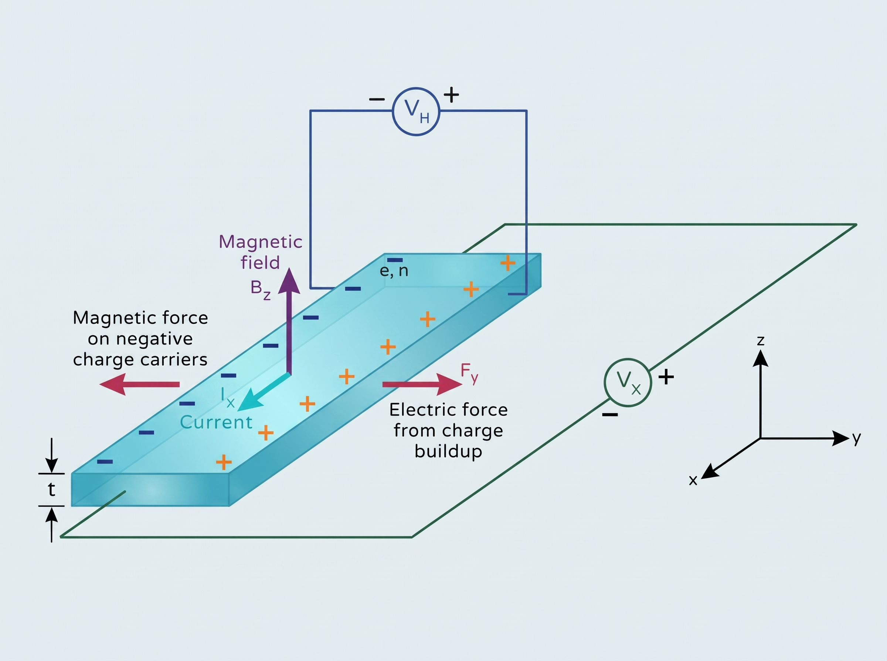

## The classical Hall effect
The **Hall effect** (found by Edwin Hall in 1879) is this: put a magnetic field across a conductor that carries a current, and a voltage shows up at right angles to both the current and the field.

**Setup:** a flat strip carries current $I$ along $x$. A magnetic field $B$ points along $z$, perpendicular to the strip.
<figure>
  
  <figcaption>A Setup Of general Hall effect.
  </figcaption>
</figure>

**Why it happens:**

1. Each moving charge $q$ with drift velocity $\textbf{V}$ feels the Lorentz force $F = q(\textbf{}{V} \times \textbf{B})$. This pushes carriers toward one edge of the strip (along $y$).
2. Charge builds up on that edge, and the opposite edge is left with the opposite charge. This sets up a transverse electric field $E_H$.
3. The pile-up stops at steady state, when the electric force balances the magnetic force: $qE_H = q v B$, so $E_H = vB$.

**Result:** the current is $I = n .q .v .A$, where $n$ is the carrier density and $A = w·t$ is the cross-section (width w, thickness t). The Hall voltage across the width is

$$V_H = E_H · w = I B / (n q t)$$

The Hall coefficient is $R_H = 1/(n q)$.