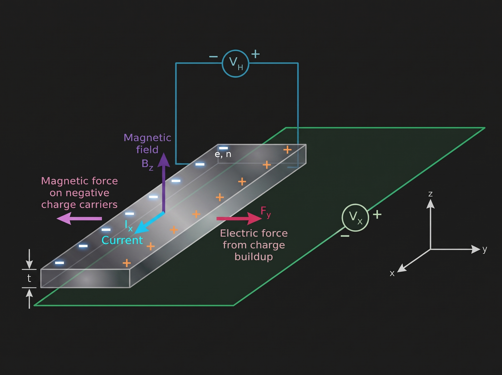
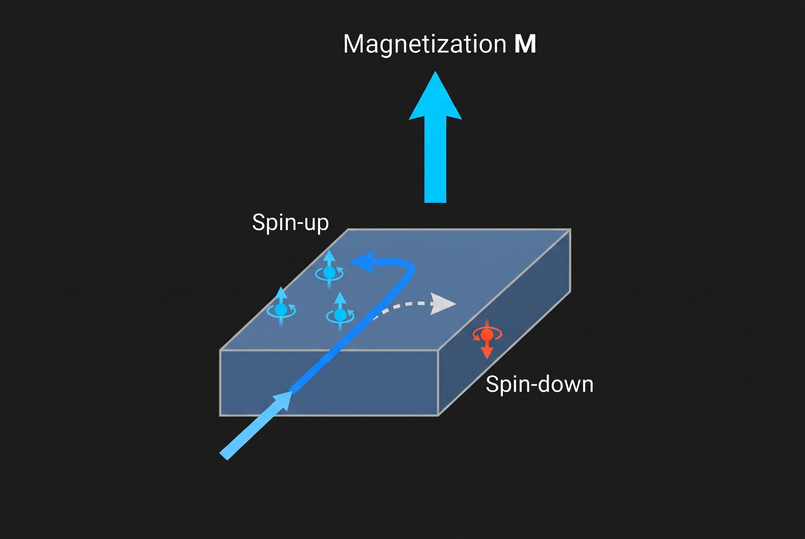

<h1 align="center">This Post is under writting...</h1>

## The classical Hall effect
The **Hall effect** (found by Edwin Hall in 1879) is this: put a magnetic field across a conductor that carries a current, and a voltage shows up at right angles to both the current and the field.

Look at the Fig-1, a flat strip carries current $I$ along $x$. A magnetic field $B$ points along $z$, perpendicular to the strip.
<figure>
  
  <figcaption>Fig-1: A Setup Of general Hall effect.
  </figcaption>
</figure>

**Why it happens:**

1. Each moving charge $q$ with drift velocity $\textbf{V}$ feels the Lorentz force $F = q(\textbf{}{V} \times \textbf{B})$. This pushes carriers toward one edge of the strip (along $y$).
2. Charge builds up on that edge, and the opposite edge is left with the opposite charge. This sets up a transverse electric field $E_H$.
3. The pile-up stops at steady state, when the electric force balances the magnetic force: $qE_H = q v B$, so $E_H = vB$.

**Result:** the current is $I = n .q .v .A$, where $n$ is the carrier density and $A = w·t$ is the cross-section (width w, thickness t). The Hall voltage across the width is

$$V_H = E_H · w = I B / (n q t)$$

The Hall coefficient is $R_H = 1/(n q)$.

## Anomalous Hall Effect
In a ferromagnet, part of the Hall voltage appears **without any external magnetic field**. Here is two causes for this, both coming from spin-orbit coupling:
- The band structure depends on spin, or
- Scattering events depend on spin.
Either way, electrons with spin along +z are pushed to one edge of the sample and electrons with spin along −z go to the other edge.

<figure>
  
  <figcaption>Fig-2: A Setup Of Anomalous Hall effect.
  </figcaption>
</figure>

**Why a voltage appears**  
A ferromagnet has **majority** and **minority** spins, so there are more electrons of one spin than the other. That means more electrons pile up on one edge than the other (Fig-2). The result is a charge imbalance between the edges, which is the Hall voltage. This effect is often used as **proof that a material is ferromagnetic**.

In consequence of the previous two phenomena, the edges end up with a **spin imbalance** as well as a charge imbalance. So both a charge current and a spin current can flow between the two edges.

**4. The formula (eq. 9.1)**  
$$R(H) = R_{o}·B + R(s)·M$$

- R(H) is the total Hall resistance.
- R₀ is the ordinary Hall coefficient, and B is the magnetic flux density.
- R(s) is the anomalous Hall coefficient, and M is the magnetization.

The first term is the normal Hall effect from the first lesson. The second term is the anomalous part.

**5. The quantum anomalous Hall effect**  
In 2D materials, the book covers a quantized version of the effect:

- Picture a 2D ferromagnetic insulator. Strong exchange splitting separates the spin-up and spin-down bands.
- Lowering that splitting makes the bands cross and swap order. This is called band inversion.
- Spin-orbit coupling then opens an energy gap where the bands cross.
- When the Fermi level sits in that gap, the material is a **Chern insulator**. Its longitudinal resistance is zero and its Hall resistance is exactly **h/e²**, with no magnetic field.
- This was first measured in Cr-doped (Bi,Sb)₂Te₃, a magnetic topological insulator. A gate voltage was used to move the Fermi level into the gap.

**6. How it connects to the spin Hall effect**  
The book's Fig. 9.1 compares the three effects side by side:

- In the normal Hall effect, the magnetic field causes the deflection.
- In the anomalous Hall effect, the magnetization does.
- In the spin Hall effect, the deflection works the same way as in the anomalous Hall effect, but the two spin populations are equal. So there is only spin build-up at the edges and no charge voltage.