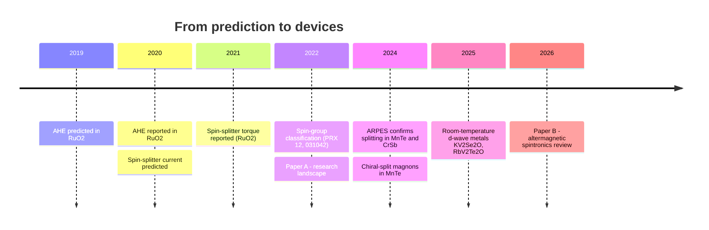
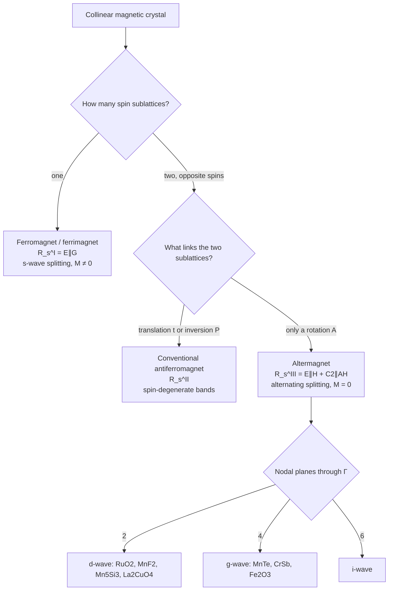
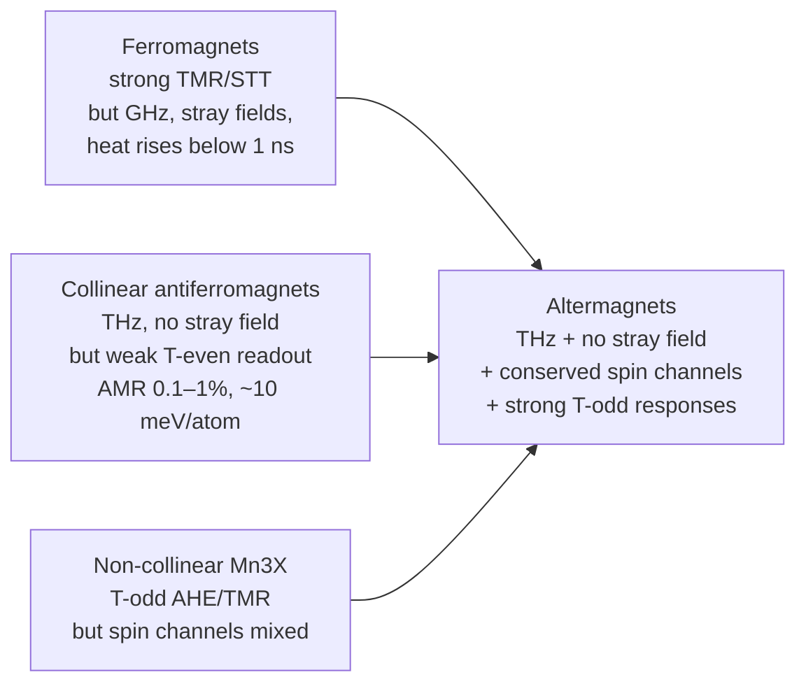
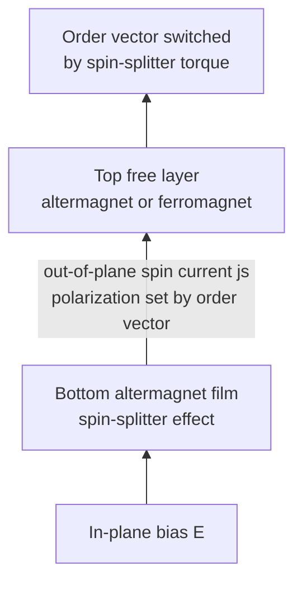
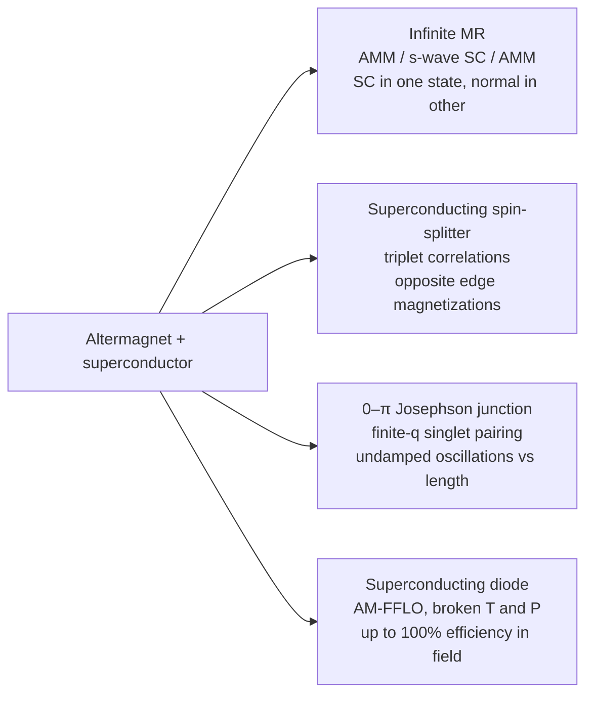
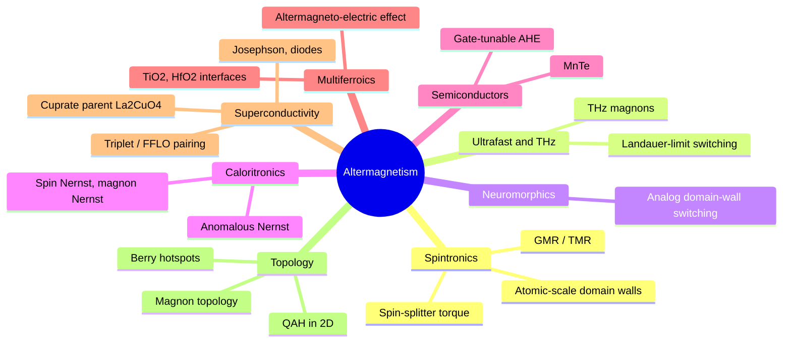

_Notes on two papers, prepared 19 Nov 2026 for Talha Mahamud (MSc Physics, Khulna University)_

- **Paper A:** L. Šmejkal, J. Sinova, T. Jungwirth, _Emerging Research Landscape of Altermagnetism_, Phys. Rev. X **12**, 040501 (2022). DOI: 10.1103/PhysRevX.12.040501
- **Paper B:** T. Jungwirth, J. Sinova, P. Wadley, D. Kriegner, H. Reichlová, F. Krizek, H. Ohno, L. Šmejkal, _Altermagnetic spintronics_, Nat. Phys. **22**, 1012–1021 (2026). DOI: 10.1038/s41567-026-03337-w

> Diagrams use **Mermaid** (renders on GitHub, GitLab, Obsidian, Typora, VS Code with a Mermaid extension) and plain-text figures. Equations use `$…$` / `$$…$$` LaTeX.

---

## Contents

1. [The two papers at a glance](https://claude.ai/chat/f92418f3-3d61-4d04-b4b3-31ae59cff6e1?artifact=cf2284e5-0b24-4a62-ac3e-91a801aa5fdb#1-the-two-papers-at-a-glance)
2. [Three collinear magnetic phases](https://claude.ai/chat/f92418f3-3d61-4d04-b4b3-31ae59cff6e1?artifact=cf2284e5-0b24-4a62-ac3e-91a801aa5fdb#2-three-collinear-magnetic-phases)
3. [Spin-group symmetry](https://claude.ai/chat/f92418f3-3d61-4d04-b4b3-31ae59cff6e1?artifact=cf2284e5-0b24-4a62-ac3e-91a801aa5fdb#3-spin-group-symmetry-why-altermagnetism-is-a-separate-phase)
4. [Material candidates](https://claude.ai/chat/f92418f3-3d61-4d04-b4b3-31ae59cff6e1?artifact=cf2284e5-0b24-4a62-ac3e-91a801aa5fdb#4-material-candidates)
5. [Physical concepts](https://claude.ai/chat/f92418f3-3d61-4d04-b4b3-31ae59cff6e1?artifact=cf2284e5-0b24-4a62-ac3e-91a801aa5fdb#5-physical-concepts-paper-a-sec-iii)
6. [Why go beyond ferromagnets](https://claude.ai/chat/f92418f3-3d61-4d04-b4b3-31ae59cff6e1?artifact=cf2284e5-0b24-4a62-ac3e-91a801aa5fdb#6-why-go-beyond-ferromagnets-paper-b)
7. [Altermagnetic spintronics: the basic effects](https://claude.ai/chat/f92418f3-3d61-4d04-b4b3-31ae59cff6e1?artifact=cf2284e5-0b24-4a62-ac3e-91a801aa5fdb#7-altermagnetic-spintronics-the-basic-effects)
8. [Interplay with ferroelectricity](https://claude.ai/chat/f92418f3-3d61-4d04-b4b3-31ae59cff6e1?artifact=cf2284e5-0b24-4a62-ac3e-91a801aa5fdb#8-interplay-with-ferroelectricity-paper-b)
9. [Interplay with superconductivity](https://claude.ai/chat/f92418f3-3d61-4d04-b4b3-31ae59cff6e1?artifact=cf2284e5-0b24-4a62-ac3e-91a801aa5fdb#9-interplay-with-superconductivity)
10. [Experiments and relativistic effects](https://claude.ai/chat/f92418f3-3d61-4d04-b4b3-31ae59cff6e1?artifact=cf2284e5-0b24-4a62-ac3e-91a801aa5fdb#10-experiments-and-the-role-of-relativistic-effects-paper-b)
11. [Other research areas](https://claude.ai/chat/f92418f3-3d61-4d04-b4b3-31ae59cff6e1?artifact=cf2284e5-0b24-4a62-ac3e-91a801aa5fdb#11-other-research-areas-paper-a-sec-iv)
12. [Synthesis, key numbers, open questions](https://claude.ai/chat/f92418f3-3d61-4d04-b4b3-31ae59cff6e1?artifact=cf2284e5-0b24-4a62-ac3e-91a801aa5fdb#12-synthesis-2022-vs-2026-key-numbers-open-questions)

---

## 1. The two papers at a glance

Altermagnetism is a **third collinear magnetic phase**. It has zero net magnetization, like an antiferromagnet, yet strongly spin-split bands that break time-reversal symmetry (T), like a ferromagnet. Paper A (2022) establishes the phase and maps its research landscape. Paper B (2026) asks what it can do for real spintronic devices.

||Paper A — the landscape|Paper B — the device outlook|
|---|---|---|
|Type, length|Perspective, 27 pages, 14 figures, 3 tables|Review, 10 pages, 4 figures|
|Core question|Why is altermagnetism a distinct phase, and where does it matter in condensed-matter physics?|How can altermagnets make spintronic memory faster, smaller and less dissipative?|
|Main tools|Spin-group symmetry, ab initio bands (RuO₂, MnF₂, FeF₂), k·p models|Device concepts (GMR, TMR, spin-splitter torque, IMR), energy-scaling arguments, survey of experiments|
|Stance|Mostly theory; experiments just starting (RuO₂ AHE, spin-splitter torque)|Theory plus four years of experiments (ARPES on MnTe/CrSb, remanent AHE, XMCD-PEEM domain imaging)|

Read them in order: Paper A supplies the symmetry language and the physics, and Paper B applies it to memory devices and adds ferroelectric and superconducting hybrids. The core authors are the same, so the notation (spin groups, d/g/i-wave, spin-splitter effect) carries over directly.



---

## 2. Three collinear magnetic phases

**Figure 1 — real space (top) and momentum space (bottom).** `↑` = spin-up sublattice, `↓` = spin-down sublattice.

```text
        FERROMAGNET              ANTIFERROMAGNET              ALTERMAGNET
   ┌──────────────────────┐  ┌──────────────────────┐  ┌──────────────────────┐
   │ Real space           │  │ Real space           │  │ Real space           │
   │                      │  │       t or P         │  │    rotation C4       │
   │    ↑         ↑       │  │    ↑ ───────→ ↓      │  │  (↑)  ───────→ [↓]   │
   │                      │  │                      │  │  ligand cage rotated │
   │  one spin sublattice │  │  linked by           │  │  90° between sites   │
   │                      │  │  translation/        │  │  → only a rotation   │
   │                      │  │  inversion           │  │    links them        │
   ├──────────────────────┤  ├──────────────────────┤  ├──────────────────────┤
   │ Momentum space       │  │ Momentum space       │  │ Momentum space       │
   │        ky            │  │        ky            │  │     ky   ↓↓          │
   │     .-""""-.  big=↑  │  │      .-""-.          │  │   \  .-""-.  /       │
   │    / .-""-. \small=↓ │  │     /      \  ↑=↓    │  │ ↑↑ (  ><  ) ↑↑  kx   │
   │   | (  ●   ) |  kx   │  │    |   ●    |  kx    │  │   /  '-..-'  \       │
   │    \ '-..-' /        │  │     \      /         │  │    nodal planes      │
   │     '-....-'         │  │      '-..-'          │  │     ky   ↓↓ (dashed  │
   │  isotropic (s-wave)  │  │  spin degenerate     │  │  diagonals) d-wave   │
   ├──────────────────────┤  ├──────────────────────┤  ├──────────────────────┤
   │ M ≠ 0                │  │ M = 0                │  │ M = 0                │
   │ bands spin split     │  │ bands degenerate     │  │ split, sign alternates│
   │ breaks T, stray field│  │ T-invariant bands    │  │ breaks T, no stray   │
   └──────────────────────┘  └──────────────────────┘  └──────────────────────┘
```

In the altermagnet, the spin-up Fermi surface is elongated along one axis and the spin-down surface along the perpendicular axis (rotated 90°). They cross on spin-degenerate **nodal planes**: 2 for d-wave, 4 for g-wave, 6 for i-wave.

What decides the phase is the **symmetry linking the opposite-spin sublattices**. A ferromagnet has only one spin sublattice. In a conventional antiferromagnet the sublattices are linked by translation or inversion, which forces spin-degenerate bands. In an altermagnet they are linked only by a rotation, because the non-magnetic ligand cages around the two sites are rotated (90° in rutile RuO₂). The real-space rotation reappears in momentum space as two spin Fermi surfaces rotated against each other.

**Superconductivity analogy (Paper A, Fig. 2).** s-wave magnetism (ferromagnet) is to d-wave magnetism (altermagnet) as s-wave superconductivity is to d-wave cuprate superconductivity. In both, the d-wave order parameter changes sign around the Fermi surface and has nodes.

|Property|Ferromagnet|Antiferromagnet|Altermagnet|
|---|---|---|---|
|Net magnetization|Large|Zero|Zero (symmetry-protected)|
|Spin splitting (no SOC)|Yes, isotropic|None|Yes, sign alternates in k|
|T symmetry of bands|Broken|Preserved|Broken|
|Resonance frequency|GHz|THz|THz|
|Stray field|Yes|No|No|
|Common in insulators|Rare|Yes|Yes|

---

## 3. Spin-group symmetry: why altermagnetism is a separate phase

The phase is defined by **non-relativistic spin groups**, not by the usual magnetic space groups. A spin-group element is a pair $[R_i ,|, R_j]$: $R_i$ acts only on spin, $R_j$ only on real space. Magnetic groups allow only $R_i = R_j$, so they cover a much narrower symmetry landscape. They cannot separate compensated from uncompensated order, or relativistic from non-relativistic effects. For example, the single group $m'm'm$ describes both RuO₂'s antiparallel order and a ferromagnetic one (Paper A, Fig. 4b).

### 3.1 The three non-trivial spin-group forms

|Phase|Spin group|What connects opposite-spin sublattices|Bands (no SOC)|
|---|---|---|---|
|Ferromagnet|$R_s^{I} = [E,\|,G]$|Nothing (one spin lattice)|Spin split, s-wave, $M \neq 0$|
|Antiferromagnet|$R_s^{II} = [E,\|,G] + [C_2,\|,G]$|Translation $t$ or inversion $P$|Spin degenerate, T-invariant|
|Altermagnet|$R_s^{III} = [E,\|,H] + [C_2,\|,AH]$|Rotation $A$ (proper/improper), not $t$ or $P$|Alternating spin splitting, d/g/i-wave, $M = 0$|

Here $G$ is the crystallographic Laue group and $H$ is the halving subgroup that keeps each spin sublattice on itself, with $G - H = AH$. $C_2$ is a 180° spin rotation about an axis perpendicular to the spins. There are **10 altermagnetic spin Laue groups** (37 spin point groups), built from 8 of the 11 Laue groups. Only $G = \bar 1,\ \bar 3,\ m\bar 3$ cannot host altermagnetism.

**Figure 2 — classifying a collinear magnet.**



### 3.2 What each symmetry buys (Paper A, Table II)

|Spin-group symmetry|Real-space meaning|Band-structure consequence|
|---|---|---|
|$[C_\infty,\|,E]$|Collinear order|Spin is a good quantum number with one k-independent axis|
|$[\bar C_2,\|,T]$|Coplanar order|$\varepsilon(s,\mathbf k) = \varepsilon(s,-\mathbf k)$: bands are inversion symmetric|
|$[E,\|,H]$|Anisotropic sublattice spin densities|Each spin's Fermi surface is anisotropic|
|$[C_2,\|,AH]$|Compensated order, $M = 0$|T broken and spin split at general k|
|$L_k \cap AH \neq \emptyset$|—|Spin degeneracy on nodal planes|
|$L_k \cap AH = \emptyset$|—|± splitting at $\mathbf k$ and $AH\mathbf k$|

### 3.3 Identification rules (checklist)

1. The unit cell holds an even number of magnetic atoms, and it need not change between the non-magnetic and magnetic phases.
2. There is no inversion centre between opposite-spin magnetic sites.
3. The two spin sublattices are related by a crystal rotation, possibly combined with translation or inversion.
4. The spin group is built from $G$, the sublattice (Wyckoff) group $H$, and the rotation $A$.

**Worked example — RuO₂ (rutile).** $G = 4/mmm$, $H = mmm$, $A = C_{4z}$, and the key element is $[C_2,|,C_{4z}t]$: flip the spin and rotate the crystal by 90° with a half translation. If you ignore the oxygen atoms, the two Ru sites look like a classic Néel antiferromagnet. The O octahedra are rotated 90° between Ru_A and Ru_B, which removes the $t$ and $P$ links and leaves only the rotation. That is why rutiles, textbook antiferromagnets since Néel, were misclassified for almost a century.

---

## 4. Material candidates

Altermagnets range from insulators to metals, from 2D to 3D, and from inorganic to organic crystals. Many contain only light elements. The one strict exclusion is 1D chains, which have no rotations. The ab initio list from Paper A (Table III), sorted by spin splitting:

|Material|Space group|Wave|Conduction|$T_{AM}$ (K)|Max. splitting (meV)|
|---|---|---|---|---|---|
|RuO₂|P4₂/mnm|d|Metal|400|1400|
|CrSb|P6₃/mmc|g|Metal|705|1200|
|MnTe|P6₃/mmc|g|Semiconductor|310|1100|
|MnO₂|P4₂/mnm|d|Insulator|—|900|
|CuF₂|P2₁/c|d|Insulator|69|350|
|KRu₄O₈|I4/m|d|Metal|—|300|
|MnF₂|P4₂/mnm|d|Insulator|67|297|
|(Cr,Fe)Sb₂|Pnma|d|Metal|—|200|
|CaCrO₃|Pnma|d|Metal|90|200|
|Fe₂O₃|R3̄c|g|Insulator|966|200|
|Mn₅Si₃|P6₃/mcm|d|Metal|≈200|150|
|κ-Cl (organic)|Pnma|d|Insulator|23|50|
|LaMnO₃|Pnma|d|Insulator|139.5|20|
|La₂CuO₄|Bmab|d|Insulator|317|10|

Paper A also names quasi-2D V₂Se₂O and Cr₂O, FeF₂, FeSb₂ (which has a metal–insulator transition), and VNb₃S₆ and CoNb₃S₆, which lack an inversion centre. Altermagnetism does not need a centrosymmetric crystal.

**What changed by 2026 (Paper B):**

- **ARPES** confirmed the T-breaking spin splitting in room-temperature MnTe (a semiconductor) and CrSb (a metal).
- Spectroscopic signatures appeared in the layered metals KV₂Se₂O and RbV₂Te₂O, whose monolayers match the 2D d-wave model.
- **Neutron diffraction** confirmed robust collinear order in MnTe, VNb₃S₆ and FeS.
- TmFeO₃, an insulating d-wave orthoferrite, is the testbed for THz switching.
- RuO₂, the 2022 workhorse, is now contested (Section 10).

---

## 5. Physical concepts (Paper A, Sec. III)

### 5.1 Lifting Kramers degeneracy — a third mechanism

Bands are Kramers degenerate whenever the crystal has PT symmetry. Before altermagnetism, two ways to split them were known:

|Mechanism|Needs|Spin texture|T in bands|
|---|---|---|---|
|Relativistic (Rashba, Dresselhaus)|Broken inversion + SOC|Non-collinear, k-dependent axis|Preserved|
|Ferromagnetic exchange / Zeeman|Net magnetization or applied field|Collinear|Broken, s-wave|
|**Altermagnetic**|Rotation-linked sublattices; needs no SOC, no inversion breaking, no M|Collinear; spin a good quantum number|Broken, alternating sign|

Two kinds of antiferromagnet stay degenerate:

- those with the $[C_2,|,t]$ symmetry (e.g. FeRh, MnBi₂Te₄);
- PT-symmetric ones such as CuMnAs and Mn₂Au, protected by $[C_2,|,\bar E]$.

Altermagnet bands keep $\varepsilon(s,\mathbf k) = \varepsilon(s,-\mathbf k)$ even in non-centrosymmetric crystals, because collinear order is also coplanar.

### 5.2 Fermi-liquid analogy

Stoner ferromagnetism is an s-wave Pomeranchuk instability in the spin-triplet channel. Altermagnetism resembles the d-wave (or g-, i-wave) version, which was thought to require strong correlations. Here it comes from crystal symmetry at the single-particle (Kohn–Sham) level. RuO₂ shows two microscopic routes:

- **Anisotropic exchange.** One spin-degenerate band splits with a momentum-dependent sign.
- **Isotropic exchange plus an anisotropic crystal field.** Two sublattice bands, rotated 90° from each other, get opposite exchange shifts. The result behaves like two interpenetrating s-wave Stoner ferromagnets with opposite moments.

Minimal two-band models:

$$ H_1 = 2t\cos k_x \cos k_y + 2t_J \sin k_x \sin k_y,\sigma_z \qquad (d_{xy}\text{-wave; nodes at } k_{x,y}=0,\pi) $$

$$ H_2 = 2t_J(\cos k_x - \cos k_y),\sigma_z,\qquad E_\pm(X,k) = \pm t_J(4-k^2),\quad E_\pm(Y,k) = \mp t_J(4-k^2) $$

### 5.3 Electron quasiparticles

- Around Γ the spin splitting is **quadratic** ($2t_J k_x k_y \sigma_z$), not linear as in the Rashba case. Γ itself is always degenerate, protected by $[C_2,|,A]$.
- **Spin winding number** = the number of nodal planes crossing Γ: 2 (d), 4 (g) or 6 (i). Rashba has winding 1 with a continuously rotating spin. In an altermagnet the spin reverses in discrete steps along one common axis.
- **Spin-polarized valleys** can sit at time-reversal-invariant momenta (X, Y), always in opposite-spin pairs. This cannot happen in non-magnetic systems, where T forbids splitting at every TRIM. Such valleys are predicted in Mn₅Si₃ and monolayer V₂Se₂O.

### 5.4 Magnons

In antiferromagnets, translation or inversion symmetry keeps the two magnon chiralities degenerate. In altermagnets the chirality splitting is lifted, with a sign that alternates across the Brillouin zone (chiral magnons, later reported in MnTe and predicted in RuO₂). The dispersion can still be linear near Γ, as in an antiferromagnet, and spin-split electrons reduce Landau damping in metals. This combination suits ps-scale THz magnonics.

### 5.5 Berry phase and anomalous Hall effect

$$ \sigma^{\mathrm{Hall}}_{xy} = -\frac{e^2}{\hbar}\sum_n \int_{BZ}\frac{d^3k}{(2\pi)^3}, f[\varepsilon_n(\mathbf k)],\Omega^z_n(\mathbf k), \qquad \Omega_n = \nabla_{\mathbf k}\times \mathcal A_n,\quad \mathcal A_n = i\langle u_{n\mathbf k}|\nabla_{\mathbf k} u_{n\mathbf k}\rangle $$

- The Berry curvature is odd under T, so an AHE requires a T-broken band structure. Altermagnets have one without magnetization.
- In an altermagnet + Rashba model, the curvature inherits the d-wave pattern: $$\Omega(\mathbf k) = \mp \frac{2t_J\lambda^2 k_x k_y}{\sqrt{4t_J^2(k_xk_y)^2 + \lambda^2 k^2}}$$ The equivalent ferromagnet + Rashba model gives an isotropic curvature.
- Nodal planes gapped by SOC become **symmetry-fixed Berry-curvature hotspots** (RuO₂, FeSb₂), unlike the accidental band crossings in ferromagnets.
- **"Crystal Hall effect":** the AHE sign flips when the moments reverse, and also when the arrangement of the non-magnetic atoms (O in RuO₂) swaps between the sublattices.
- 2D insulating altermagnets are candidates for high-temperature, zero-field quantum anomalous Hall states. Spin-space groups also allow non-relativistic band topology and magnon topology.

---

## 6. Why go beyond ferromagnets (Paper B)

Ferromagnetic MRAM works and is now mass-produced for embedded memory. It is limited by speed, heat and stray fields, and compensated magnets address all three.

**Today's MRAM.**

- **Read:** an MTJ uses TMR. Parallel electrodes give low resistance, antiparallel give high, and the ratio can reach hundreds of per cent.
- **Write, STT-MRAM:** two terminals, using the same spin-polarized current.
- **Write, SOT-MRAM:** three terminals. A spin-Hall current from an adjacent heavy metal switches the free layer, at the cost of a larger bit cell.
- **Stray fields:** neither operation needs them. They only limit scaling, and suppressing them requires synthetic-antiferromagnet stacks of more than 10 materials.

**The energy argument.**

$$ E_{\min} = k_B T \ln 2 ;\approx; \text{meV at room temperature (Landauer limit)} $$

$$ E_{\text{Joule}} \sim R I^2 t_p,\qquad I \approx \text{const for } t_p \gtrsim \tau_{\text{prec}},\qquad I \propto 1/t_p \text{ for } t_p < \tau_{\text{prec}} $$

- Ferromagnets precess at GHz ($\tau_{\text{prec}} \approx$ ns), a rate set by their weak anisotropy. Below 1 ns the write current must grow as $1/t_p$, so Joule heat rises about 1000× from ns to ps pulses.
- Landauer-limit operation has been shown in ferromagnetic bits, but only at µs switching times (below MHz).
- By the uncertainty principle, a meV single-photon pulse lasts at least about 1 ps. The fastest _and_ least dissipative bit therefore operates in the THz/ps regime, which ferromagnets cannot reach.

**Figure 3 — where each magnet class stands.**



- **Conventional antiferromagnets** (CuMnAs, Mn₂Au):
    - Good: THz dynamics, no stray field, and room-temperature electrical switching down to ps pulses with no rise in energy at short pulses.
    - Limits: the energy is still about 10 meV per atom. Reading and writing use weak T-symmetric effects: AMR of 0.1–1 %, spin-orbit torque, or heating-induced nanotexture states.
- **Non-collinear compensated magnets** (Mn₃Sn, Mn₃Pt…):
    - Good: T-odd AHE and TMR.
    - Limit: non-collinear order mixes spin-up and spin-down states much as SOC does, so the clean spin channels behind strong ferromagnetic TMR and STT are missing.

---

## 7. Altermagnetic spintronics: the basic effects

The same d-wave Fermi surfaces give three responses:

- a spin-polarized current along one axis;
- the opposite polarization along the perpendicular axis;
- a pure transverse spin current along the diagonal.

These are the building blocks of every device concept below.

**Figure 4 — current response of a d-wave altermagnet (after Paper B, Fig. 1c).**

```text
   Bias E ∥ x                 Bias E ∥ y                 Bias E ∥ diagonal (x = y)

   ───────────────▶ j↑        ▲ j↓                        j↑   ↗  (deflected one way)
   current mostly from        │                         E ───────▶   j  (unpolarized)
   spin-up sublattice         │                         j↓   ↘  (deflected other way)
                              │
   → spin-polarized ↑         → spin-polarized ↓         → longitudinal j unpolarized
                                (reverses on 90°            + transverse PURE spin
                                 rotation of E)              current js  ⟂ E
                                                            = SPIN-SPLITTER EFFECT
   Bias E ∥ z (out of plane, 2D model): unpolarized, no transverse spin current.
```

### 7.1 Spin-dependent conductivity

Spin-split, anisotropic Fermi surfaces give spin-dependent group velocities, $\partial E_+/\partial k_i \neq \partial E_-/\partial k_i$. Along the main d-wave axes:

$$ \sigma_{+,xx} \neq \sigma_{-,xx},\qquad \sigma_{\pm,xx} = \sigma_{\mp,yy} $$

The polarization reverses when the bias rotates by 90°, which has no ferromagnetic counterpart. It also reverses when the altermagnetic order vector reverses. The order vector is defined like the Néel vector, as the difference of the sublattice magnetizations.

### 7.2 Spin-splitter effect (SSE) vs spin-Hall effect (SHE)

||Spin-splitter effect|Spin-Hall effect|
|---|---|---|
|Origin|Non-relativistic altermagnetic order|Relativistic spin–orbit coupling|
|T symmetry|T-odd|T-even|
|Spin polarization axis|Set by the order vector|Set by the bias direction|
|Strength|Predicted ~100× the SHE; RuO₂ theory: 34° splitting angle, 28 % charge-to-spin ratio|Reference|

Paper A predicts a RuO₂ spin conductivity about 3× higher than the best of 20,000 screened spin-Hall materials.

### 7.3 Magnetoresistance (readout)

**Figure 5 — device stacks (after Paper B, Figs. 2–3).** AMM = altermagnetic metal, AMI = altermagnetic insulator, AMFE = altermagnetic ferroelectric, NM = normal metal, NI = normal insulator, SC = superconductor.

```text
      IMR                GMR                TMR              Spin-filter TMR        Electric-field TMR
  ┌──────────┐      ┌──────────┐      ┌──────────┐        ┌──────────┐           ┌──────────┐
  │   AMM    │      │   AMM    │      │   AMM    │        │    NM    │           │   AMM    │
  ├──────────┤      ├──────────┤      ├──────────┤        ├──────────┤           ├──────────┤
  │    SC    │      │    NM    │      │    NI    │        │   AMI    │           │    NI    │
  ├──────────┤      ├──────────┤      ├──────────┤        ├──────────┤           ├──────────┤
  │   AMM    │      │   AMM    │      │   AMM    │        │    NM    │           │   AMFE   │
  └──────────┘      └──────────┘      └──────────┘        ├──────────┤           ├──────────┤
  spacer SC in one    spin-dependent     valley-resolved   │   AMI    │           │    NM    │
  state, normal in    conductivities     tunnelling        ├──────────┤           └──────────┘
  the other (cryo)                                         │    NM    │           write by voltage P
                                                           └──────────┘
   Parallel orders  → large current (low R)
   Antiparallel     → small current (high R)
```

- **GMR, current in plane** (metal spacer). Set by the ratio $R_\sigma = \sigma_{+,xx}/\sigma_{-,xx}$; RuO₂ ab initio values reach about 100 %. GMR from momentum-integrated conductivities is allowed **only in d-wave** altermagnets.
- **GMR, current perpendicular, and TMR.** These need an orientation in which the out-of-plane current is polarized. TMR follows a per-valley Jullière formula with $R_n = n_+(M_1)/n_-(M_1)$. About 100 % is predicted for RuO₂|TiO₂|RuO₂ and for Mn₅Si₃.
- **Spin-neutral-current TMR.** Even when the net tunnelling current is unpolarized, individual momenta are spin polarized, so TMR survives. TMR is symmetry-allowed in **all** d-, g- and i-wave altermagnets, for any crystal orientation.

$$ \mathrm{GMR} = \tfrac14\Big(R_\sigma + \tfrac{1}{R_\sigma} - 2\Big),\qquad \mathrm{TMR} = \tfrac12\Big(R_n + \tfrac{1}{R_n} - 2\Big) $$

### 7.4 Writing: spin-transfer and spin-splitter torques

The spin-polarized longitudinal and transverse currents can switch the order, or drive textures, by spin-transfer torque.

The **spin-splitter torque (SST)** works like this:

- An in-plane bias in an altermagnetic film sends a spin current out of plane into an adjacent free layer.
- It has the SOT geometry, so no current passes through the tunnel barrier.
- The source is non-relativistic, and the spin axis is set by the order vector rather than the current direction.
- Early RuO₂ experiments (2021–22) reported SST signatures.



### 7.5 Insulating altermagnets as spin filters

Unlike ferromagnetic order, altermagnetic order is common in insulators. A thin altermagnetic insulator spin-filters an unpolarized current coming from a normal metal, so two such barriers in series give TMR. This allows all-insulating, low-dissipation stacks.

### 7.6 Domain walls and textures (Paper A, Sec. IV A)

Information can be stored in self-assembled textures as well as in uniform bits. An atomically sharp domain wall between opposite order vectors would act as a self-assembled, atomic-scale GMR junction. It would combine digital, ferromagnet-type readout with the analogue, neuromorphic switching seen in CuMnAs.

---

## 8. Interplay with ferroelectricity (Paper B)

Insulating altermagnets can be switched by an electric field instead of a current, which removes Joule heating from writing. Ferromagnetic ferroelectrics are rare because ferromagnetism favours metals. Altermagnetic ferroelectrics (multiferroics) are predicted, and they enable the **altermagneto-electric effect**.

**Mechanism.** The local spin density on each magnetic atom has two parts:

- an isotropic s-wave **dipole**, ordered antiparallel (Néel-like) between neighbours;
- an anisotropic **d-wave component**, identical on both atoms, i.e. ordered _ferroically_. This non-Néel ferroic part is a key signature of altermagnetism.

The local uniaxial distortion around each magnetic atom fixes the sign of the d-wave component. In a ferroelectric altermagnet, reversing the polarization P reverses that distortion, so the d-wave spin density flips while the dipoles stay put. The alternating spin polarization of the bands in momentum space flips with it.

**Figure 6 — altermagneto-electric effect (after Paper B, Fig. 3c).**

```text
            +P                                           −P
   Real space:                                  Real space:
     atom A: dipole ↑  + d-wave lobe  (+)         atom A: dipole ↑  + d-wave lobe  (−)
     atom B: dipole ↓  + d-wave lobe  (+)         atom B: dipole ↓  + d-wave lobe  (−)
              (dipoles Néel, lobes ferroic)                (dipoles unchanged, lobes flipped)

   Momentum space:                              Momentum space:
        spin-up FS along kx                          spin-up FS along ky
        spin-down FS along ky       ── P → −P ─▶     spin-down FS along kx
                                                (band spin polarization reversed)

   Coupling: strong, non-relativistic, mediated by lattice distortion
   → non-volatile electric-field switching, read out by TMR
```

**Devices.** TMR stacks with altermagnetic-ferroelectric (AMFE) electrodes or barriers: write by voltage, read by TMR. Paper A had already pointed to the structural match between RuO₂ and the dielectric TiO₂, to ferroelectric HfO₂ in CMOS, and to CaMnO₃ as a candidate altermagnetic multiferroic.

**Towards Landauer.** In TmFeO₃, a ps THz pulse delivering about 1 meV per atom reoriented the spin axis. The reorientation was transient and at low temperature, not a stable non-volatile switch. It still shows that Landauer-scale, ps writing is a realistic, though difficult, goal.

---

## 9. Interplay with superconductivity

The link starts with La₂CuO₄: the insulating parent compound of the high-Tc cuprates is itself a d-wave altermagnet (Paper A). That points to altermagnetic fluctuations as a possible pairing mechanism. It also motivates proximity devices for cryogenic, stray-field-free electronics.

### 9.1 Which Cooper pairs fit (Paper A; Paper B, Fig. 4)

|Region of the Brillouin zone|Allowed pairing|Gap structure|
|---|---|---|
|Spin-degenerate nodal planes|Spin-singlet, even parity (incl. d-wave)|$\Delta_{\uparrow\uparrow}=\Delta_{\downarrow\downarrow}=0$, $\Delta_{\downarrow\uparrow} = -\Delta_{\uparrow\downarrow}$; unitary, zero net spin|
|Spin-split regions|Spin-triplet, odd parity|Non-unitary like a ferromagnet; partner $\Delta_{\downarrow\downarrow}(AH\mathbf k) = \Delta_{\uparrow\uparrow}(\mathbf k)$ keeps net spin zero|
|Spin-split Fermi surfaces|Spin-singlet, finite momentum $q \neq 0$ (FFLO-like)|Order parameter with π-phase nodes; $q$ locked to crystal axes|

### 9.2 Device concepts (Paper B)



- **Infinite magnetoresistance (IMR).** The inverse proximity effect suppresses Tc in the spacer differently for parallel and antiparallel order. At a fixed temperature the spacer is superconducting in one state and normal in the other, giving a very large cryogenic readout.
- **Superconducting spin-splitter effect.** Spin-triplet correlations let a supercurrent injected from an s-wave electrode create opposite magnetizations at the two edges. Both flip when the supercurrent reverses, making this a dissipationless analogue of the SSE.
- **0–π Josephson junctions.** S/altermagnet/S junctions switch between 0 and π ground states as the altermagnet's length changes. Unlike ferromagnetic junctions, the oscillations can stay undamped over a wide range of lengths, which eases fabrication.
- **Superconducting diode.** Coexisting altermagnetic and FFLO order (AM-FFLO) breaks T and P, giving non-reciprocal transport: a supercurrent flows one way and a dissipative current the other. In a magnetic field the efficiency can in principle reach 100 %. Because q locks to crystal axes, the rotational Goldstone mode is removed and a sizeable gap survives.

Altermagnetic semiconductors such as MnTe, where the gap and the g-wave splitting are both about 0.1–1 eV, add gating and doping as tuning knobs. Ferromagnetic semiconductors failed here because raising Tc toward room temperature degraded their semiconducting properties.

---

## 10. Experiments and the role of relativistic effects (Paper B)

The central experimental task is to separate what the altermagnetic order does from what SOC or an applied field does. The order breaks spin-rotation, crystal-rotation and T symmetries spontaneously. SOC breaks spin-rotation symmetry explicitly, and the Zeeman term breaks both spin-rotation and T.

### 10.1 RuO₂: from workhorse to controversy

- **2019–22 (Paper A, Table I):** the AHE was predicted in 2019 and reported in 2020; spin current and torque were predicted in 2020 and reported in 2021.
- **SHE contamination:** searches for the spin-splitter effect found the competing **relativistic SHE** playing a major role.
- **Zeeman contamination:** early AHE data were taken in a magnetic field, so the Zeeman contribution competes.
- **Inconsistent samples:** some films show magnetic signals and others none. Paper B attributes this to fragile order in correlated ruthenates, sensitive to film thickness, strain, impurities and disorder.

### 10.2 Cleaner evidence

|Probe|Material|What it shows|
|---|---|---|
|ARPES|MnTe, CrSb|T-breaking non-relativistic spin splitting ("altermagnetic lifting of Kramers degeneracy")|
|Spectroscopy|KV₂Se₂O, RbV₂Te₂O|Room-temperature d-wave metals|
|Zero-field remanent AHE|Mn₅Si₃ films, MnTe, VNb₃S₆, FeS|AHE without the Zeeman term; collinear order confirmed by neutrons|
|XMCD (a.c. T-odd response)|MnTe|Altermagnetic part dominates at zero field; magnetization part takes over at a few tesla|
|XMCD-PEEM imaging|MnTe|Single-domain states, designed domain walls and vortices|
|Magnon measurements|MnTe|Chiral-split magnons|

### 10.3 Constructive interplay with SOC

- **The AHE needs SOC.** In collinear magnets the AHE vanishes without SOC. The Hall vector has the same symmetry as a weak magnetization, but the remanent AHE comes from the strong T breaking of the compensated order (intrinsic Berry curvature), not from that weak moment.
- **SOC enables conductivity in g- and i-wave magnets.** Their non-relativistic spin conductivity and SSE vanish by symmetry. In MnTe, whose easy axis lies in the c-plane, SOC lifts the degeneracy on the c-plane nodal plane. This creates a d-wave-like, collinear spin polarization along c, split by about 100 meV thanks to the heavy Te atoms, and restores a spin-dependent conductivity.
- **Collinear relativistic polarization.** Strong _collinear_ spin polarization from SOC was a long-standing goal of relativistic spintronics. In 2D altermagnetic topological insulators it may enable quantum spin or anomalous Hall transport.

---

## 11. Other research areas (Paper A, Sec. IV)

**Figure 7 — the research landscape (after Paper A, Fig. 14).**



|Area|Why altermagnets help|
|---|---|
|Ultrafast photomagnetism|THz magnons; T-odd magneto-optics can track the order vector in insulators such as TmFeO₃|
|Neuromorphics|Atomically sharp domain walls act as self-assembled GMR junctions, enabling logic-in-memory beyond the von Neumann bottleneck|
|Thermoelectrics|Anomalous Nernst effect and thermal GMR/TMR/STT; semiconductors and metal–insulator systems such as FeSb₂ widen the choice of materials|
|Spin caloritronics|Non-relativistic spin-Nernst response, expected to exceed the relativistic one by orders of magnitude; spin magnon Nernst effect from chiral-split magnons|
|Field-effect electronics|High-$T_{AM}$ semiconductors such as MnTe with spontaneous AHE, tunable by gating near the band edges|
|Multiferroics|Interfaces with TiO₂ and HfO₂; CaMnO₃ as a candidate altermagnetic multiferroic|
|Superconductivity|Altermagnetic cuprate parent compound; triplet and singlet pairing; Andreev reflection and Majorana states at interfaces|
|Topology|Non-relativistic spin-group topology, magnon topology, axion electrodynamics (outlook)|

---

## 12. Synthesis: 2022 vs 2026, key numbers, open questions

### 12.1 How the picture moved

|Topic|2022 (Paper A)|2026 (Paper B)|
|---|---|---|
|Status of the phase|Newly classified by spin groups; theory-led|Confirmed by ARPES (MnTe, CrSb), neutrons, XMCD|
|Flagship material|RuO₂|MnTe, CrSb, Mn₅Si₃; RuO₂ contested|
|Spin currents|SSE and SST predicted in RuO₂|SHE contamination recognised; SOC-enabled SSE in g-wave MnTe|
|Readout|GMR and TMR predicted (~100 %)|Adds spin-neutral TMR, insulating spin-filter TMR and IMR|
|Writing|SST, STT; THz switching in TmFeO₃|Adds electric-field switching via the altermagneto-electric effect|
|Superconductivity|Pairing-symmetry analysis; cuprate link|Concrete devices: IMR, SC-SSE, 0–π junctions, 100 % diode|
|Domains|Proposed atomic-wall GMR|Domains, walls and vortices imaged and engineered in MnTe|

### 12.2 Numbers worth remembering

- **Spin splitting:** up to about 1.4 eV (RuO₂, theory), 1.2 eV (CrSb) and 1.1 eV (MnTe). This is comparable to ferromagnets and about 10× the record relativistic splittings.
- **Ordering temperature:** $T_{AM}$ up to 705 K (CrSb) and 966 K (Fe₂O₃).
- **RuO₂ theory:** SSE angle 34°, charge-to-spin conversion 28 %, GMR and TMR about 100 %.
- **Energy scale:** the Landauer limit $k_BT\ln 2$ is about a meV at 300 K, and THz pulses of about 1 ps are the time–energy optimum.
- **Switching energies so far:** about 10 meV per atom in conventional antiferromagnets; about 1 meV per atom in TmFeO₃ with THz pulses, but only transiently.

### 12.3 Open questions

- Is RuO₂ magnetically ordered at all, and if so under which strain, thickness and stoichiometry?
- Can the spin-splitter effect be cleanly isolated from the SHE in a d-wave metal?
- Can room-temperature altermagnetic TMR match ferromagnetic MTJ values in a real device?
- Can non-volatile electric-field switching via the altermagneto-electric effect be demonstrated in a real multiferroic?
- Can domain-wall and texture control, as shown in MnTe, become reproducible enough for devices?
- Do altermagnetic fluctuations contribute to pairing in doped cuprates?

### 12.4 Relevance to simulation work (atomistic spin dynamics / micromagnetics)

For VAMPIRE or mumax+ models, the papers suggest these ingredients:

- two sublattices linked by a rotation, not by a translation;
- anisotropic exchange $J_{ij}$ that differs along x and y for each sublattice and is rotated 90° between them (the real-space origin of d-wave splitting);
- THz, exchange-dominated dynamics;
- torques whose spin axis follows the order vector (SST), not the current direction (SHE).

---

### Glossary

|Term|Meaning|
|---|---|
|AHE|Anomalous Hall effect|
|AMR|Anisotropic magnetoresistance|
|ARPES|Angle-resolved photoemission spectroscopy|
|FFLO|Fulde–Ferrell–Larkin–Ovchinnikov (finite-momentum) superconducting state|
|GMR / TMR|Giant / tunnelling magnetoresistance|
|IMR|Infinite magnetoresistance (superconducting spacer)|
|MTJ|Magnetic tunnel junction|
|SOC|Spin–orbit coupling|
|SOT / STT|Spin–orbit torque / spin-transfer torque|
|SSE / SST|Spin-splitter effect / spin-splitter torque|
|SHE|Spin-Hall effect|
|TRIM|Time-reversal-invariant momentum|
|XMCD-PEEM|X-ray magnetic circular dichroism with photoemission electron microscopy|